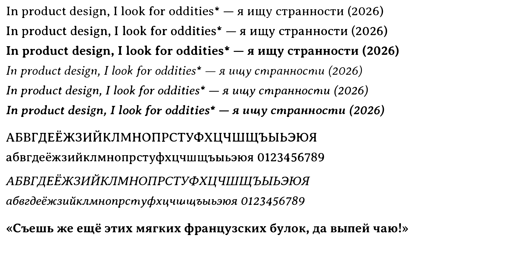

# Splav

**Splav** (Сплав, "alloy") is [Averia Serif Libre](https://fonts.google.com/specimen/Averia+Serif+Libre) with Cyrillic, made the way Averia was made: by averaging.

Averia's designer, Dan Sayers, split the outline of every letter in 725 fonts into hundreds of points and averaged them. Corners that sit in slightly different places in each font melt into soft, rounded shapes, which is where Averia's character comes from. Averia has no Cyrillic. Splav adds it with the same method, so the softness comes from the averaging, not from imitation.

The name is about the method and the material: many fonts melted into one, and the type alloy («типографский сплав») metal type was cast from.



**[Try it in the browser](https://kidpudel.github.io/splav/)** · **[Download](https://github.com/KidPudel/splav/releases/latest)**

## Status

Version 0.2. Six styles, each a complete font: all of Averia (Latin, figures, punctuation, symbols and kerning) plus the Russian alphabet (А–я, Ё ё).

| Style | Built on | File |
| --- | --- | --- |
| Light | Averia Serif Libre Light | `Splav-Light` |
| Regular | Averia Serif Libre Regular | `Splav-Regular` |
| Bold | Averia Serif Libre Bold | `Splav-Bold` |
| Light Italic | Averia Serif Libre Light Italic | `Splav-LightItalic` |
| Italic | Averia Serif Libre Italic | `Splav-Italic` |
| Bold Italic | Averia Serif Libre Bold Italic | `Splav-BoldItalic` |

Each is in `fonts/ttf/` (to install on a computer) and `fonts/woff2/` (for the web). Latin text set in Splav looks exactly like Averia, so you can use Splav on its own.

## Use

On a computer, install the `.ttf` files from the [download](https://github.com/KidPudel/splav/releases/latest).

On the web, load the styles you use from jsDelivr:

```css
@font-face { font-family: 'Splav'; font-weight: 300; src: url('https://cdn.jsdelivr.net/gh/KidPudel/splav@v0.2.0/fonts/woff2/Splav-Light.woff2') format('woff2'); }
@font-face { font-family: 'Splav'; font-weight: 400; src: url('https://cdn.jsdelivr.net/gh/KidPudel/splav@v0.2.0/fonts/woff2/Splav-Regular.woff2') format('woff2'); }
@font-face { font-family: 'Splav'; font-weight: 700; src: url('https://cdn.jsdelivr.net/gh/KidPudel/splav@v0.2.0/fonts/woff2/Splav-Bold.woff2') format('woff2'); }
@font-face { font-family: 'Splav'; font-weight: 300; font-style: italic; src: url('https://cdn.jsdelivr.net/gh/KidPudel/splav@v0.2.0/fonts/woff2/Splav-LightItalic.woff2') format('woff2'); }
@font-face { font-family: 'Splav'; font-weight: 400; font-style: italic; src: url('https://cdn.jsdelivr.net/gh/KidPudel/splav@v0.2.0/fonts/woff2/Splav-Italic.woff2') format('woff2'); }
@font-face { font-family: 'Splav'; font-weight: 700; font-style: italic; src: url('https://cdn.jsdelivr.net/gh/KidPudel/splav@v0.2.0/fonts/woff2/Splav-BoldItalic.woff2') format('woff2'); }

body { font-family: 'Splav', serif; }
```

## How it is made

1. **Sources.** 18 open-licence text serifs with well-made Cyrillic, chosen from every serif with Cyrillic on Google Fonts. Fonts with Bulgarian or old letter forms in their upright style, and display faces, were left out, so the average is not pulled towards shapes Russian readers would find wrong. See [SOURCES.md](SOURCES.md) and the sheets in `specimens/`.
2. **The method, checked on Latin first.** The same averaging applied to the sources' Latin letters reproduces Averia's look and overlaps the real Averia by 68–86% before fitting and 78–89% after, depending on the style (`specimens/latin-check-roman400.png`). That fit (width, height, weight, slant) is then applied to the Cyrillic.
3. **Averaging** (`scripts/avg.py`). Each glyph is cleaned of overlaps, every contour is resampled into 320 evenly spaced points, contours are matched across fonts (same structure, same direction, best cyclic start), and the points are averaged. Fonts that draw a letter in a different form (for example the two italic «в») are left out of that letter, as are far outliers, so two forms never blend into mush.
4. **Shared shapes.** Letters that look the same as Latin (А В Е М Н О Р С Т Х, а е о р с у х, Ё ё) use Averia's own outlines, as Cyrillic extensions usually do.
5. **Softness** (`scripts/soften.py`). Averia averaged 725 fonts; only a few dozen serifs have Cyrillic, and they agree with each other far more, so the plain average of the uprights keeps crisp serifs and high contrast. Averaging a shape with many slightly shifted copies of itself, and keeping what most of them cover, is a blur followed by a threshold. Both are fitted on Latin (`scripts/calibrate_soft.py`), so the averaged Latin matches real Averia: its overlap with Averia goes from 84–89% to 87–90%, and serifs round off the way Averia's do. The italic averages already match Averia, so they are left as they are.
6. **Outlines** are written as smooth quadratic splines and added to Averia's own font, with Averia's kerning carried over to the shared letters (`scripts/build.py`). The result is exported as TTF and WOFF2.

## Rebuild

```sh
sh scripts/build_all.sh
```

It creates a Python environment in `.venv`, downloads the sources into `build/` (about 55 MB, not kept in the repository), makes static instances, fits the averages (and the softness of the uprights) to each Averia style, builds all six styles and renders `specimens/splav.png`.

## Licence

Splav is free and open: [SIL Open Font License 1.1](OFL.txt), with no Reserved Font Name. It is built on Averia Serif Libre and its Cyrillic is derived from 18 OFL fonts, all credited in `OFL.txt`. It does not use any of their reserved names, including "Averia".

Made by Igor Kupchinenko, 2026.
